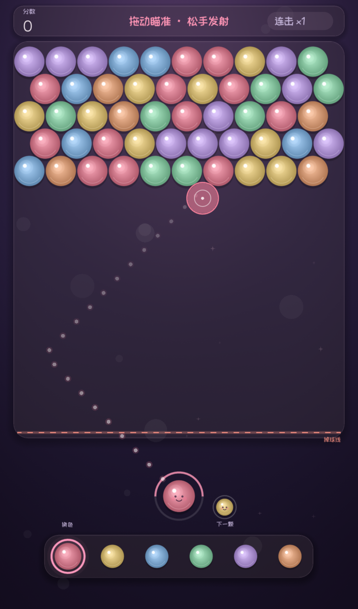
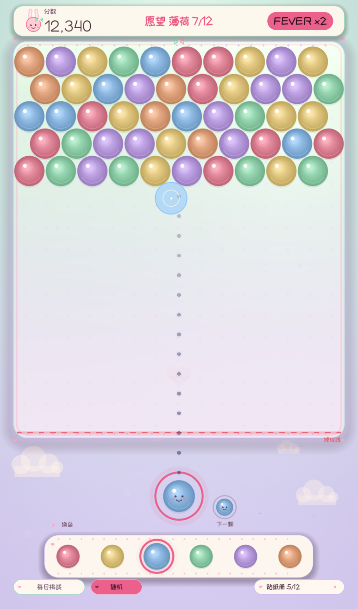

# WeiXi · 玩不死的泡泡龙

泡泡龙射击消除 + 经典三消融合的零挫败解压游戏。

**没有 Game Over，只有一直玩的泡泡、愿望和贴纸。**



## 玩法特色

- **零失败**：球堆触底只会掉行，不会结束游戏
- **射击 + 三消融合**：瞄准发射，或点两个相邻球互换
- **两个免费作弊**：随时换当前球颜色；双击棋盘球换任意颜色
- **愿望卡**：无失败的软目标，完成 +25 星星并解锁贴纸
- **星星能量 / Fever**：满环进入 Fever，3 次消除得分 ×2
- **特殊泡泡**：5+ 下一发星星炸弹；7+ 彩虹洗色
- **反弹 / 掉行奖励**：`BANK!` 加分，掉行给星尘
- **每日挑战**：日期哈希固定种子，同一天同一盘
- **贴纸册**：12 张矢量贴纸，本地持久化
- **马卡龙 UI**：薄荷/薰衣草/奶油/玫瑰/柠檬，全部矢量绘制
- **奖励时刻动效**：Fever 开启、愿望达成、贴纸收集、星星/彩虹/BANK 都有专属庆祝
- **落球反馈**：挤压回弹 + 接触涟漪 + 奶油尘 + 小爱心

## 操作

| 操作 | 效果 |
| --- | --- |
| 拖动 / 点击空位 | 瞄准并发射 |
| 点两个相邻球 | 互换位置，形成 3 连即消除 |
| 点底部颜色条 | 换当前球颜色 |
| 双击棋盘球 | 弹出调色板，换成任意颜色 |
| 底部“每日挑战” | 开始当天固定种子的新局 |
| 底部“随机” | 开始随机新局 |
| 底部“贴纸册” | 查看 12 张贴纸收集进度 |

## 运行

需要 **Godot 4.7.1**。

```bash
godot --path .
```

macOS 上如果编辑器启动遇到 MoltenVK 问题，使用：

```bash
/Applications/Godot.app/Contents/MacOS/Godot --path . \
  --rendering-method gl_compatibility \
  --rendering-driver opengl3_angle
```

更多环境说明见 [启动文档.md](启动文档.md)，完整玩法规格见 [玩法.md](玩法.md)。

## 测试

项目使用自建无依赖测试脚本，当前 **128 个测试全绿**：

```bash
/Applications/Godot.app/Contents/MacOS/Godot --headless --path . \
  --rendering-method gl_compatibility \
  --rendering-driver opengl3_angle \
  --script tests/run_tests.gd
```

## 目录结构

```text
src/
  logic/      纯 GDScript 玩法逻辑（棋盘、计分、愿望、贴纸、每日种子）
  scenes/     主场景与编排层
  ui/         全部矢量 UI（HUD、背板、球、发射器、贴纸册、特效）
tests/        128 个测试
fonts/        ZCOOL KuaiLe + Fredoka（SIL OFL 1.1）
docs/         4K / 8K 截图
tools/        图标、Web 注入、deb/NSIS 打包脚本
export/       已打包的分发产物
```

## 截图

| 4K 游戏画面 | 4K 贴纸册 |
| --- | --- |
|  |  |

更多细节：[背板 1:1](docs/ui-board-crop.png) · [8K 控制区](docs/ui-8k-controls.png) · [落球 1:1](docs/ui-landing-crop.png)

## 许可证

Copyright (C) 2026 chenpeigen

SPDX-License-Identifier: GPL-3.0-or-later

WeiXi is free software: you can redistribute it and/or modify it under the
terms of the GNU General Public License as published by the Free Software
Foundation, either version 3 of the License, or (at your option) any later
version.

WeiXi is distributed in the hope that it will be useful, but WITHOUT ANY
WARRANTY; without even the implied warranty of MERCHANTABILITY or FITNESS FOR
A PARTICULAR PURPOSE. See the GNU General Public License for more details.

You should have received a copy of the GNU General Public License along with
this program. If not, see <https://www.gnu.org/licenses/>.

完整协议见 [LICENSE](LICENSE)。

## 第三方资源

- **Godot Engine**：MIT License，<https://godotengine.org/license>
- **ZCOOL KuaiLe** 字体：SIL Open Font License 1.1，见 [fonts/OFL.txt](fonts/OFL.txt)
- **Fredoka** 字体：SIL Open Font License 1.1，见 [fonts/Fredoka-OFL.txt](fonts/Fredoka-OFL.txt)

以上第三方资源仍分别适用其原始许可证，不被本项目的 GPL 覆盖。
